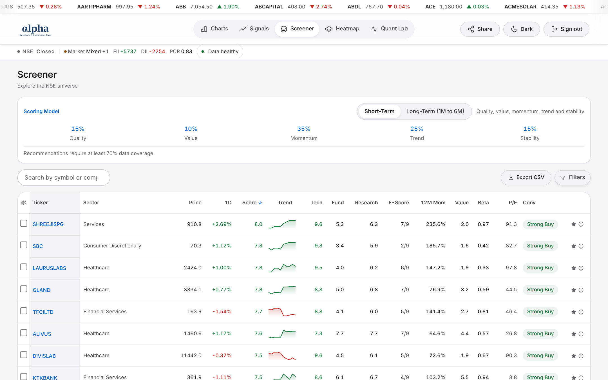
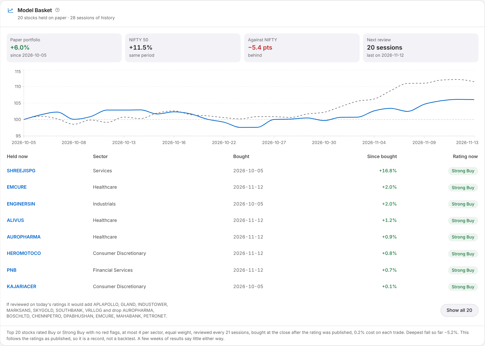
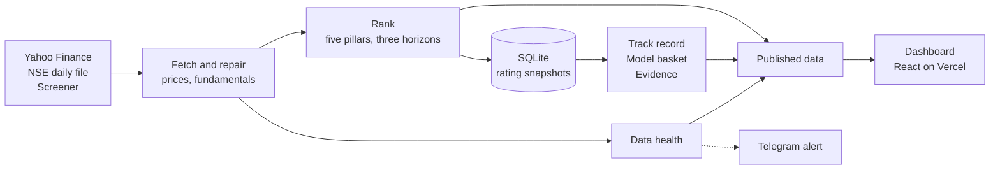

<div align="center">

<picture>
  <source media="(prefers-color-scheme: dark)" srcset="assets/Alpha_v2_Final-Dark.svg">
  
</picture>

# Quant Alpha

**Evidence-first stock research for the Indian market.**

About 500 NSE stocks, rated several times a day, with every rating<br>
explained and every claim checked against what happened next.

<br>

[](https://github.com/abhy-kumar/quant-alpha/actions/workflows/daily_scan.yml)
[](https://github.com/abhy-kumar/quant-alpha/actions/workflows/checks.yml)


[](LICENSE)

<br>

[**Open the dashboard**](https://quant-alpha-sage.vercel.app)
&nbsp;&nbsp;·&nbsp;&nbsp;
[How a stock is rated](#how-a-stock-is-rated)
&nbsp;&nbsp;·&nbsp;&nbsp;
[How much to trust it](#how-much-to-trust-it)
&nbsp;&nbsp;·&nbsp;&nbsp;
[Run it locally](#run-it-locally)

<br>

<picture>
  <source media="(prefers-color-scheme: dark)" srcset="assets/readme/screener-dark.png">
  
</picture>

<sub>Built for the Alpha Research & Investment Club, Faculty of Management Studies, University of Delhi.<br>
Educational research. Not investment advice, and not a price forecast.</sub>

</div>

<br>

## What it does

<table>
<tr>
<td width="33%" valign="top">

### Rates

Scores each stock from 0 to 10 on quality, value, momentum, trend and stability, for three horizons. Every score is a rank against other stocks, not a predicted return.

</td>
<td width="33%" valign="top">

### Explains

Each stock says why it has its rating: where it ranks, what helped, what held it back, any red flag, and what the next rating up requires.

</td>
<td width="33%" valign="top">

### Checks itself

A paper portfolio follows the ratings as published. A track record shows what each rating went on to do. Each input is tested against later returns.

</td>
</tr>
</table>

| Screen | What you see | Sign-in |
| :-- | :-- | :-: |
| **Charts** | Daily and weekly prices, indicators, company profile, live quotes | |
| **Screener** | Every tracked stock with filters, comparison and a watchlist | Scores |
| **Heatmap** | Scores by sector | |
| **Signals** | The highest-rated stocks, and your own holdings against today's ratings | Yes |
| **Quant Lab** | Model basket, rating changes, track record, model evidence, backtests | Yes |
| **Data health** | Which sources answered and how complete each input is | |

<br>

<div align="center">
<picture>
  <source media="(prefers-color-scheme: dark)" srcset="assets/readme/basket-dark.png">
  
</picture>
<br>
<sub>The model basket in Quant Lab. It is shown as it stands, including when it trails the index.</sub>
</div>

<br>

## How a stock is rated

Each input is turned into a percentile against other stocks, grouped into five pillars, and blended with weights that depend on the horizon.

| Pillar | Inputs | Compared within |
| :-- | :-- | :-- |
| **Quality** | Return on equity, assets and capital; margin; cash quality; leverage | Sector |
| **Value** | Earnings, book and free-cash-flow yields | Sector |
| **Momentum** | 12-month and 6-month return, each skipping the latest month | All stocks |
| **Trend** | Price against its 50-day and 200-day averages | All stocks |
| **Stability** | Volatility and downside risk over three months | All stocks |

| Horizon | Quality | Value | Momentum | Trend | Stability |
| :-- | :-: | :-: | :-: | :-: | :-: |
| Short term | 15% | 10% | **35%** | 25% | 15% |
| Balanced | **25%** | 20% | **25%** | 15% | 15% |
| Long term | **35%** | 30% | 15% | 5% | 15% |

| Rating | Rule |
| :-- | :-- |
| **Strong Buy** | Top 10%, score of 6.5 or more, at least 85% of inputs available, no red flags |
| **Buy** | Top 30%, score of 5.5 or more |
| **Hold** | Everything in between |
| **Caution** | Bottom 40% with a score under 5, or any red flag |
| **Avoid** | Bottom 20% with a score under 4.5, or negative book equity |
| **Insufficient data** | Too few inputs, a stale price, or under a year of history |

The weights are round on purpose: with the history available, finer weights cannot be told apart from noise. Banks and other financial companies use measures that suit their accounts. Any change to inputs, weights or rules creates a new model version, and old ratings are never rewritten.

Full specification: [docs/RANKING.md](docs/RANKING.md)

<br>

## How much to trust it

Quant Lab is built so the model can be judged by results.

| | |
| :-- | :-- |
| **Model basket** | The 20 highest-rated stocks, at most four per sector, held on paper and reviewed monthly. It follows the ratings exactly as published, so it is a record and not a backtest. |
| **Track record** | What stocks did after each rating, over one week, one month and three months, beside NIFTY. |
| **Model evidence** | How well each input ranked stocks by their next-month return, on up to ten years of prices, plus 14 candidate inputs. A candidate is promoted only if it helps in both halves of the history. |
| **Data health** | Every scan reports how complete each input is, whether each source answered, and how many closing prices agree with the NSE daily file. |

> [!IMPORTANT]
> Ratings rank stocks against each other. When the whole market falls, most highly rated stocks fall too. About half of individual picks lose money over a month even when a basket of twenty does well, so the edge shows up across many stocks and not in two or three.

<details>
<summary><b>Known limits</b></summary>
<br>

- The database holds about two years of prices, and fundamentals have only been recorded since June 2026. Quality and value inputs get no verdict until a year of snapshots exists.
- The ten-year price study only covers stocks tracked today, which flatters the past.
- Backtests in Quant Lab use a separate price-only strategy. They are not replays of the live ratings, and their totals move with the start date.
- Prices come from Yahoo Finance, which sometimes misses a demerger or split. The pipeline repairs overnight jumps larger than the exchange allows.
- A value that could not be fetched is shown as unavailable, never as zero or a neutral number.
- Promoter pledging is known only when Screener flags it as material.

</details>

<br>

## How it works



A scheduled GitHub Actions job runs the scan on weekdays at about 4:07, 9:37, 12:37, 16:11 and 22:07 IST, commits the results, and Vercel redeploys. A Saturday job fetches ten years of prices for the evidence, fills in matured outcomes and refreshes the backtests.

<br>

## Run it locally

You need **Python 3.12** and **Node.js 22** or newer. Commands are for Windows PowerShell; on macOS or Linux use `.venv/bin/python` in place of `.venv/Scripts/python.exe`.

```powershell
git clone https://github.com/abhy-kumar/quant-alpha.git
Set-Location quant-alpha
python -m venv .venv
& .venv/Scripts/python.exe -m pip install -r requirements.txt pytest
& .venv/Scripts/python.exe db_split_join.py join
& .venv/Scripts/python.exe scripts/setup_hooks.py
```

Then start the dashboard in a second terminal:

```powershell
Set-Location frontend
npm ci
Copy-Item .env.example .env.local   # then set AUTH_EMAIL and AUTH_PASSWORD
npm run dev
```

<details>
<summary><b>Everyday commands</b></summary>
<br>

| Task | Command, from the repository root |
| :-- | :-- |
| Run Python tests | `& .venv/Scripts/python.exe -m pytest -q` |
| Run a full scan (calls external sources) | `& .venv/Scripts/python.exe -m engine.scanner` |
| Refresh the factor evidence | `& .venv/Scripts/python.exe scripts/run_factor_research.py --period 10y` |
| Repair quote gaps | `& .venv/Scripts/python.exe scripts/repair_quote_gaps.py` |
| Rebuild outcomes and backtests | `& .venv/Scripts/python.exe scripts/backfill_research.py` |
| Frontend tests, lint, build | `npm test`, `npm run lint`, `npm run build` in `frontend` |

</details>

<details>
<summary><b>The database in Git</b></summary>
<br>

`data/market_scans.db` is local only. Git tracks it as 40 MB pieces named `data/market_scans.db.part_*`.

1. After every `git pull`, run `db_split_join.py join` to rebuild your local database from the pulled pieces.
2. Scripts and scans then change the local database.
3. The pre-commit hook splits it back into pieces when you commit.

`split` refuses to run when your local database is older than the pieces on disk, because that would overwrite newer data with a stale copy. Pass `--force` only if replacing them is what you intend. Never commit the joined database or its WAL files.

</details>

<details>
<summary><b>Deploy on Vercel</b></summary>
<br>

| Setting | Value |
| :-- | :-- |
| Framework | Vite |
| Root directory | `frontend` |
| Build command | `npm run build` |
| Output directory | `dist` |
| Node.js | 22.x or newer |

| Environment variable | Purpose |
| :-- | :-- |
| `AUTH_EMAIL` | Shared account email |
| `AUTH_PASSWORD` | Shared account password |
| `AUTH_SESSION_SECRET` | Optional signing secret; otherwise derived from the password |

Never prefix credentials with `VITE_`, which would ship them to the browser, and do not reuse the old hardcoded password that remains in Git history. Redeploy after changing settings.

Sessions are signed, HttpOnly, SameSite=Strict cookies that expire after eight hours. The login rate limit is per server instance; add Vercel Firewall rules if you need a stricter one.

| Request | Access |
| :-- | :-- |
| `/api/data?resource=market` | Public prices and facts; scores need a session |
| `/api/data?resource=quant`, `scores`, `strategies`, `runs`, `run` | Signed-in account |
| `/api/chart`, `/api/live_data` | Public, NSE and BSE symbols only |

> [!WARNING]
> The sign-in protects the hosted site, not the data. The research files are tracked in this public repository under `frontend/public`, so anyone can read them on GitHub. Make the repository private if the scores must stay private.

</details>

<details>
<summary><b>Automation and alerts</b></summary>
<br>

- `.github/workflows/daily_scan.yml` runs the weekday scans and the Saturday refresh. Scans never overlap, and data commits retry with a rebase if a push fails.
- A Telegram summary is sent after publication when the `TELEGRAM_BOT_TOKEN` and `TELEGRAM_CHAT_ID` secrets are set. It leads with a data warning when a scan ran with gaps.
- `.github/workflows/checks.yml` runs the Python and frontend tests, lint and build on every push, and checks that research data is absent from the static build.
- The NSE holiday calendar for 2026 lives in `engine/market_calendar.py` and `frontend/server/market_calendar.json`. Update both for later years.

</details>

<details>
<summary><b>Code map</b></summary>
<br>

| Path | Responsibility |
| :-- | :-- |
| `data_pipeline/` | Price and fundamentals ingestion, price repair, SQLite storage, outcomes |
| `engine/ranking.py` | The rating model |
| `engine/paper_portfolio.py`, `engine/track_record.py` | Model basket, rating changes and results |
| `engine/factor_research.py` | Evidence for each input and candidate |
| `engine/data_health.py` | Per-scan data health report and price cross-check |
| `engine/` (other) | Scanning, indicators, portfolios, backtests |
| `frontend/api/`, `frontend/server/` | Data, chart, quote and login endpoints; sessions |
| `frontend/src/` | The React dashboard ([design rules](frontend/DESIGN.md)) |
| `notifications/` | Telegram summary and the weekend refresh |
| `scripts/` | Research refresh, repairs and hook setup |
| `tests/`, `frontend/tests/` | Python and frontend tests |

</details>

<br>

---

<div align="center">
<sub>
Developed for the Alpha Research & Investment Club, Faculty of Management Studies, University of Delhi.<br>
Released under the <a href="LICENSE">Apache License 2.0 with Commons Clause</a>.
</sub>
</div>
