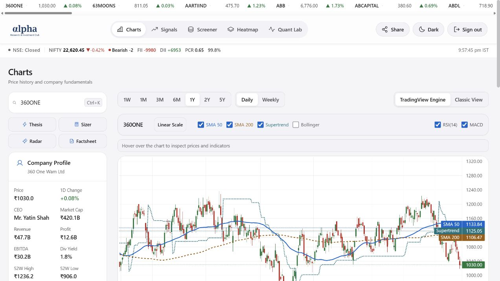

<div align="center">
  
  <p><strong>NSE stock screening, factor research and portfolio analysis.</strong></p>
  <p>Built for the Alpha Research & Investment Club, Faculty of Management Studies (FMS), University of Delhi.</p>
</div>

[](https://github.com/abhy-kumar/quant-alpha/actions/workflows/daily_scan.yml)
[](https://github.com/abhy-kumar/quant-alpha/actions/workflows/checks.yml)
[](https://www.python.org/)
[](https://react.dev/)
[](https://www.typescriptlang.org/)

[Open the dashboard](https://quant-alpha-sage.vercel.app) · [Ranking specification](docs/RANKING.md) · [Design rules](frontend/DESIGN.md)



Quant Alpha scans about 500 of the most traded NSE stocks several times a day,
ranks them against each other, and publishes the result as a dashboard. It is an
educational research tool. It is not investment advice, and it does not predict
prices.

## Contents

- [What you get](#what-you-get)
- [How a stock is rated](#how-a-stock-is-rated)
- [How much to trust it](#how-much-to-trust-it)
- [Run it locally](#run-it-locally)
- [Everyday commands](#everyday-commands)
- [The database in Git](#the-database-in-git)
- [Deploy on Vercel](#deploy-on-vercel)
- [Automation](#automation)
- [Code map](#code-map)

## What you get

| Screen | What it shows | Sign-in |
| --- | --- | --- |
| Charts | Daily and weekly prices, indicators, company profile, live quotes | No |
| Screener | Every tracked stock with filters, comparison and watchlist | Scores need sign-in |
| Heatmap | Research scores by sector | No |
| Signals | The highest-rated stocks for a short or long horizon | Yes |
| Quant Lab | Track record, model evidence, backtests, model portfolios, strategy builder | Yes |

Live quotes refresh every 30 seconds while NSE is open and every five minutes
when it is closed. The strip at the top of the page scrolls through every tracked
stock and pauses when you point at it.

## How a stock is rated

Each stock gets a score from 0 to 10 for three horizons, built from five groups
of inputs. Every input is turned into a percentile against other stocks, so a
score says where a stock stands relative to its peers, not how much it will
return.

| Group | Inputs | Compared within |
| --- | --- | --- |
| Quality | Return on equity, assets and capital; margin; cash quality; leverage | Sector |
| Value | Earnings, book and free-cash-flow yields | Sector |
| Momentum | 12-month and 6-month return, each skipping the latest month | All stocks |
| Trend | Price against its 50-day and 200-day averages | All stocks |
| Stability | Volatility and downside risk over three months | All stocks |

| Horizon | Quality | Value | Momentum | Trend | Stability |
| --- | --- | --- | --- | --- | --- |
| Short term | 15% | 10% | 35% | 25% | 15% |
| Balanced | 25% | 20% | 25% | 15% | 15% |
| Long term | 35% | 30% | 15% | 5% | 15% |

Ratings follow from a stock's rank among eligible stocks:

| Rating | Rule |
| --- | --- |
| Strong Buy | Top 10%, score of 6.5 or more, at least 85% of inputs available, no red flags |
| Buy | Top 30%, score of 5.5 or more |
| Hold | Everything in between |
| Caution | Bottom 40% with a score under 5, or any red flag |
| Avoid | Bottom 20% with a score under 4.5, or negative book equity |
| Insufficient data | Too few inputs, a stale price, or under a year of history |

Banks and other financial companies use measures that suit their accounts. The
weights are deliberately round: with the history available, finer weights cannot
be told apart from noise. Any change to inputs, weights or rating rules creates a
new model version, and old ratings are never rewritten. The full specification
is in [docs/RANKING.md](docs/RANKING.md).

## How much to trust it

Quant Lab shows two things so you can judge the model by results:

- **Track record.** What stocks did after each published rating, held for one
  week, one month or three months, beside NIFTY over the same days.
- **Model evidence.** How well each input ranked stocks by their next-month
  return, and whether any of 14 candidate inputs would improve the model. A
  candidate is only promoted if it helps in both halves of the history.

Things to keep in mind:

- Ratings rank stocks against each other. When the whole market falls, most
  highly rated stocks fall too.
- Roughly half of individual picks lose money over a month even when a basket of
  20 does well. The edge shows up across many stocks, not in two or three.
- The price history in the database covers about two years, and fundamentals
  have only been recorded since June 2026. A weekly job extends the price study
  to ten years, but only for stocks tracked today, which flatters the past.
- Backtests in Quant Lab use price-only proxies. They are not replays of the live
  model, and their totals move noticeably with the start date.
- Prices from Yahoo Finance sometimes miss a demerger or split. The pipeline
  repairs overnight jumps larger than the exchange allows; see
  [docs/RANKING.md](docs/RANKING.md).

## Run it locally

You need Python 3.12 and Node.js 22 or newer. Commands are for Windows
PowerShell; on macOS or Linux use `.venv/bin/python` in place of
`.venv/Scripts/python.exe`.

```powershell
git clone https://github.com/abhy-kumar/quant-alpha.git
Set-Location quant-alpha
python -m venv .venv
& .venv/Scripts/python.exe -m pip install -r requirements.txt pytest
& .venv/Scripts/python.exe db_split_join.py join
& .venv/Scripts/python.exe scripts/setup_hooks.py
```

Then start the dashboard in a second terminal:

```powershell
Set-Location frontend
npm ci
Copy-Item .env.example .env.local   # then set AUTH_EMAIL and AUTH_PASSWORD
npm run dev
```

The development server also serves the API routes. Environment files and the
joined database are ignored by Git.

## Everyday commands

| Task | Command (from the repository root) |
| --- | --- |
| Run Python tests | `& .venv/Scripts/python.exe -m pytest -q` |
| Run a full scan (calls external data sources) | `& .venv/Scripts/python.exe -m engine.scanner` |
| Refresh the factor evidence | `& .venv/Scripts/python.exe scripts/run_factor_research.py --period 10y` |
| Repair quote gaps | `& .venv/Scripts/python.exe scripts/repair_quote_gaps.py` |
| Rebuild outcomes and backtests | `& .venv/Scripts/python.exe scripts/backfill_research.py` |
| Frontend tests, lint, build | `npm test`, `npm run lint`, `npm run build` (in `frontend`) |

## The database in Git

`data/market_scans.db` is local only. Git tracks it as 40 MB pieces named
`data/market_scans.db.part_*`.

1. After every `git pull`, run `db_split_join.py join` to rebuild your local
   database from the pulled pieces.
2. Scripts and scans then change the local database.
3. The pre-commit hook splits it back into pieces when you commit.

`split` refuses to run when your local database is older than the pieces on
disk, because that would overwrite newer data with a stale copy. Pass `--force`
only if replacing them is what you intend. Never commit the joined database or
its WAL files.

## Deploy on Vercel

| Setting | Value |
| --- | --- |
| Framework | Vite |
| Root directory | `frontend` |
| Build command | `npm run build` |
| Output directory | `dist` |
| Node.js | 22.x or newer |

| Environment variable | Purpose |
| --- | --- |
| `AUTH_EMAIL` | Shared account email |
| `AUTH_PASSWORD` | Shared account password |
| `AUTH_SESSION_SECRET` | Optional signing secret; otherwise derived from the password |

Never prefix credentials with `VITE_`, which would ship them to the browser, and
do not reuse the old hardcoded password that remains in Git history. Redeploy
after changing settings. Without the login settings, sign-in is refused while the
public screens keep working.

Sessions are signed, HttpOnly, SameSite=Strict cookies that expire after eight
hours. The login rate limit is per server instance; add Vercel Firewall rules if
you need a stricter limit.

| Request | Access |
| --- | --- |
| `/api/data?resource=market` | Public prices and facts; scores need a session |
| `/api/data?resource=quant`, `scores`, `strategies`, `runs`, `run` | Signed-in account |
| `/api/chart`, `/api/live_data` | Public, NSE and BSE symbols only |

**The sign-in protects the hosted site, not the data.** The research files are
tracked in this public repository under `frontend/public`, so anyone can read
them on GitHub. Make the repository private if the scores must stay private.

If the data API returns 503, check the function logs for a missing or invalid
bundled file.

## Automation

`.github/workflows/daily_scan.yml` runs:

- a market scan on weekdays at about 4:07, 9:37, 12:37, 16:11 and 22:07 IST;
- a Saturday job at about 9:07 IST that fetches ten years of prices for the
  factor evidence, fills in matured outcomes and refreshes the backtests.

Scans never overlap. Data commits retry with a rebase if the push fails. A
Telegram summary is sent after publication when the `TELEGRAM_BOT_TOKEN` and
`TELEGRAM_CHAT_ID` secrets are set; manual runs send it only when
`send_notifications` is ticked. GitHub may start scheduled runs late.

`.github/workflows/checks.yml` runs the Python and frontend tests, lint and build
on every push, and checks that research data is absent from the static build.

The NSE holiday calendar for 2026 lives in `engine/market_calendar.py` and
`frontend/server/market_calendar.json`. Update both for later years.

## Code map

| Path | Responsibility |
| --- | --- |
| `data_pipeline/` | Price and fundamentals ingestion, price repair, SQLite storage, outcomes |
| `engine/ranking.py` | The rating model |
| `engine/factor_research.py`, `engine/track_record.py` | Evidence and results shown in Quant Lab |
| `engine/` (other) | Scanning, indicators, portfolios, backtests |
| `frontend/api/`, `frontend/server/` | Data, chart, quote and login endpoints; sessions |
| `frontend/src/` | The React dashboard |
| `notifications/` | Telegram summary and the weekend refresh |
| `scripts/` | Research refresh, repairs and hook setup |
| `tests/`, `frontend/tests/` | Python and frontend tests |
| `db_split_join.py` | Joins and splits the database pieces |

## License and attribution

Developed for the Alpha Research and Investment Club, Faculty of Management
Studies (FMS), University of Delhi. Released under the
[Apache License 2.0 with Commons Clause](LICENSE).
